# Neivos Facture — Application mobile de traitement de factures

**Neivos Facture** est une application mobile développée avec **Flutter et Dart**, connectée à un backend **Node.js / Express.js** et à une base de données relationnelle. Le projet de fin d’études explore un workflow de traitement de factures assisté par reconnaissance optique de caractères (**OCR**).

## Sommaire

- [Présentation](#présentation)
- [Fonctionnalités](#fonctionnalités)
- [Captures d’écran](#captures-décran)
  - [Authentification et accueil](#1-authentification-et-accueil)
  - [OCR et extraction des données](#2-ocr-et-extraction-des-données)
  - [Documents et exports](#3-documents-et-exports)
  - [Profil et paramètres](#4-profil-et-paramètres)
  - [Assistance](#5-assistance)
- [Technologies](#technologies)
- [Architecture générale](#architecture-générale)
- [Installation et configuration](#installation-et-configuration)
- [Auteur](#auteur)

## Présentation

Neivos Facture vise à faciliter la numérisation, l’extraction et l’organisation des informations contenues dans des factures. L’application mobile communique avec une API REST et s’appuie sur un workflow OCR pour aider à récupérer les informations présentes dans les documents.

Les informations extraites doivent être vérifiées avant toute utilisation comptable. La qualité du résultat dépend notamment de la lisibilité de la facture et de la disponibilité du service OCR configuré.

## Fonctionnalités

- Création de compte et authentification.
- Tableau de bord et navigation entre les fonctionnalités.
- Sélection ou traitement d’images de factures.
- Reconnaissance optique de caractères (OCR) et extraction assistée des données.
- Consultation et organisation des documents.
- Présentation des résultats d’extraction pour vérification.
- Export ou génération de documents PDF et Excel, selon les fonctionnalités implémentées.
- Gestion du profil et des paramètres.
- Accès à l’assistance et à la messagerie.

## Technologies

| Domaine | Technologies |
|---|---|
| Application mobile | Flutter, Dart |
| Backend | Node.js, Express.js |
| Base de données | MySQL / base relationnelle selon la configuration |
| Communication | API REST |
| Traitement documentaire | OCR |
| Exports | PDF, Excel, selon l’implémentation du projet |

## Architecture générale

```text
Neivos-Facture/
├── application Flutter/   # Interface mobile
├── backend/               # API et logique serveur
├── docs/
│   └── images/            # Captures d’écran présentées dans ce README
└── README.md
```

Cette représentation est indicative : consultez l’arborescence du dépôt pour connaître les chemins exacts des composants.

## Installation et configuration

Les commandes suivantes sont à adapter aux dossiers et scripts réellement présents dans le dépôt.

### Application Flutter

```bash
flutter pub get
flutter run
```

### Backend Node.js

Depuis le dossier du backend qui contient le fichier `package.json` :

```bash
npm install
npm run
```

La commande `npm run` affiche les scripts disponibles. Lancez ensuite le script de démarrage défini dans le projet.

Configurez les paramètres de base de données et les URL des services dans les fichiers d’environnement prévus. **Ne publiez jamais de mots de passe, clés d’API ou autres secrets.**

## Auteur

**Wissem Attouf** — Software Engineer | Full-Stack Developer

Projet de fin d’études réalisé au sein de **Neivos Groupe**.

- [GitHub](https://github.com/WissemAttouf)
- [LinkedIn](https://www.linkedin.com/in/wissem-attouf-452509226/)
- [Portfolio](https://wissem-portfolio.vercel.app/)
- [E-mail](mailto:wattouf35@gmail.com)

---

## 📸 Captures d’écran

<p align="center">
  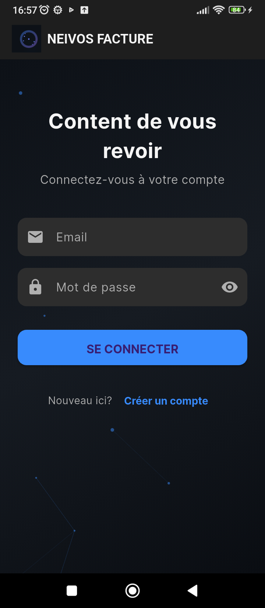
  <br><strong>Authentification</strong>
  <br><em>Écran de connexion à Neivos Facture.</em>
</p>

<p align="center">
  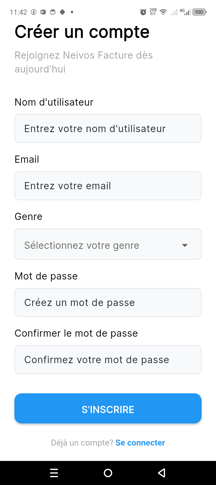
  <br><strong>Inscription</strong>
  <br><em>Écran de création d’un compte utilisateur.</em>
</p>

<p align="center">
  
  <br><strong>Accueil</strong>
  <br><em>Vue d’accueil de l’application.</em>
</p>

<p align="center">
  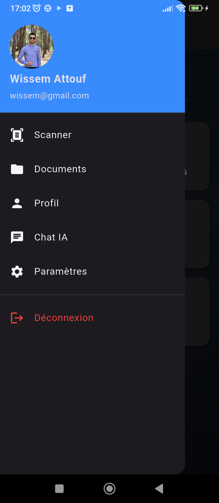
  <br><strong>Accueil — vue complémentaire</strong>
  <br><em>Deuxième aperçu de l’espace d’accueil.</em>
</p>

<p align="center">
  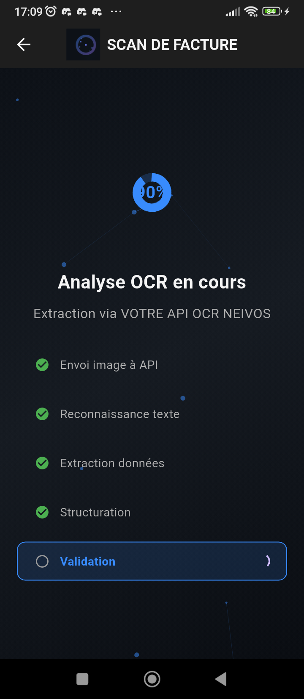
  <br><strong>Traitement OCR</strong>
  <br><em>Écran consacré au traitement OCR des factures.</em>
</p>

<p align="center">
  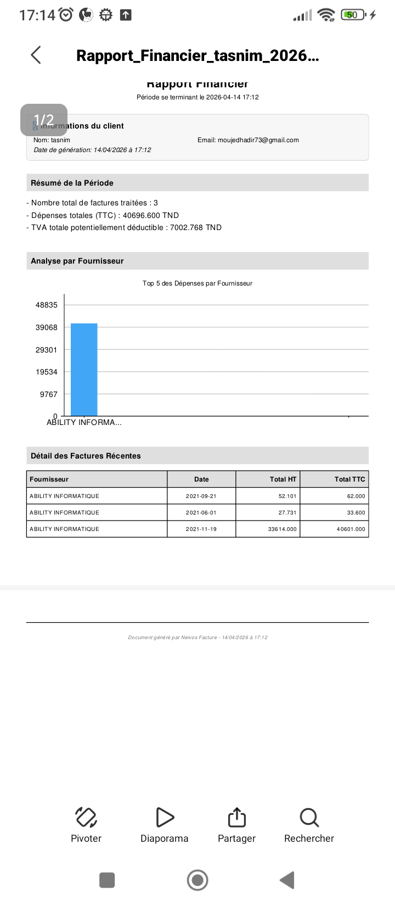
  <br><strong>OCR de PDF</strong>
  <br><em>Aperçu du traitement OCR d’un document PDF.</em>
</p>

<p align="center">
  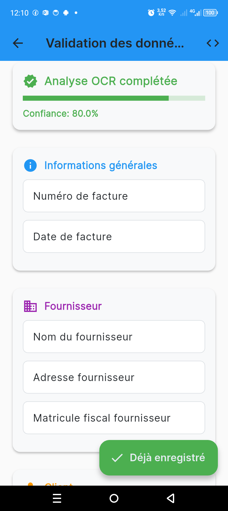
  <br><strong>Données extraites</strong>
  <br><em>Affichage des données extraites depuis une facture.</em>
</p>

<p align="center">
  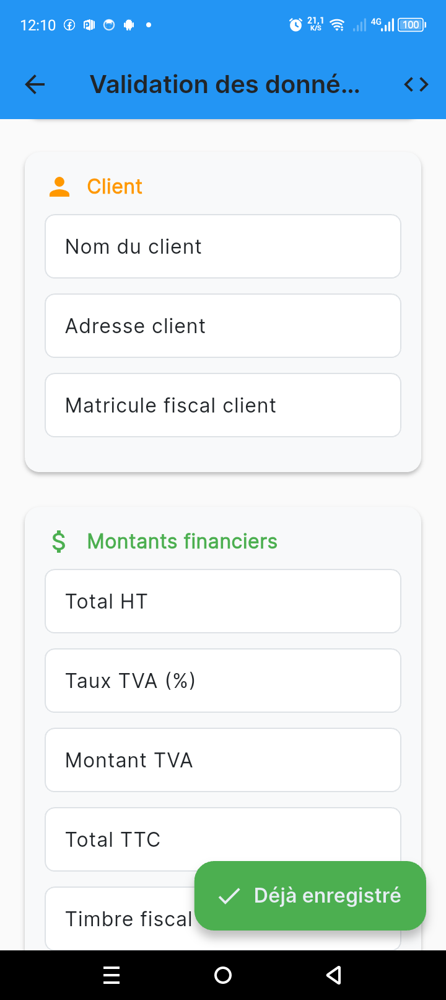
  <br><strong>Données extraites — détails</strong>
  <br><em>Vue complémentaire des informations extraites.</em>
</p>

<p align="center">
  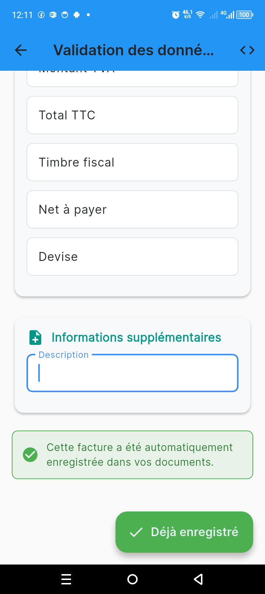
  <br><strong>Résultats d’extraction</strong>
  <br><em>Autre aperçu des résultats d’extraction.</em>
</p>

<p align="center">
  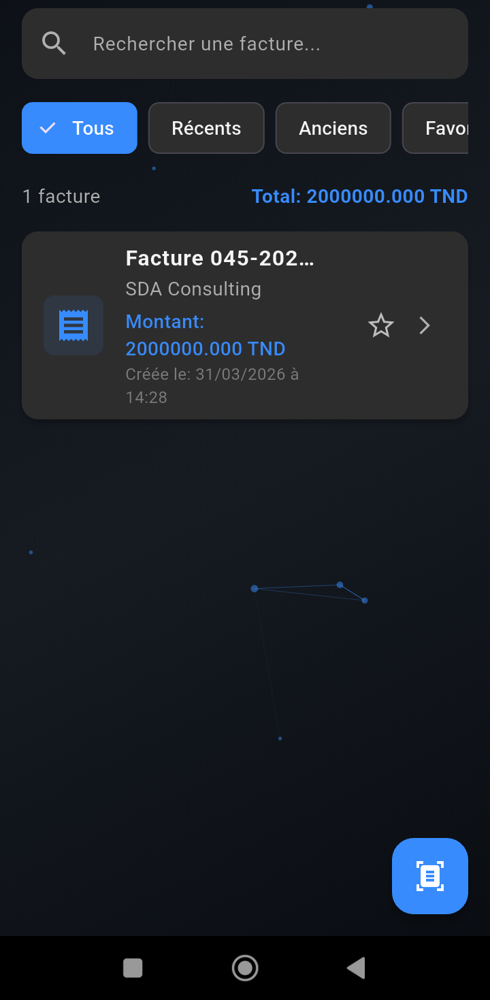
  <br><strong>Documents</strong>
  <br><em>Espace de consultation et d’organisation des documents.</em>
</p>

<p align="center">
  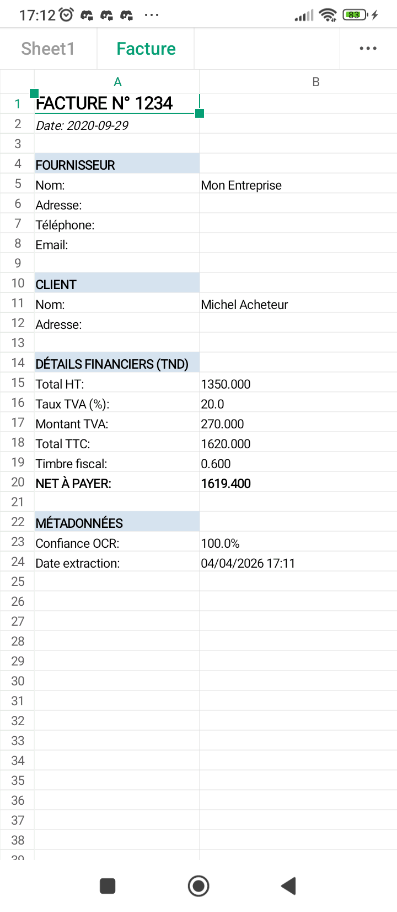
  <br><strong>Export Excel</strong>
  <br><em>Aperçu associé à l’export ou au document Excel.</em>
</p>

<p align="center">
  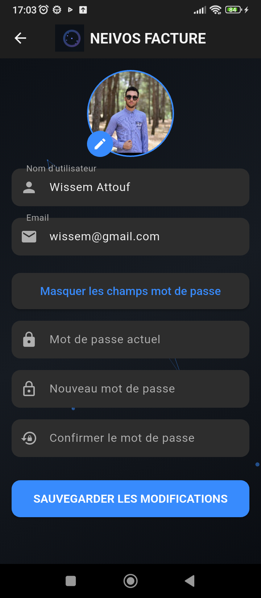
  <br><strong>Profil utilisateur</strong>
  <br><em>Écran du profil utilisateur.</em>
</p>

<p align="center">
  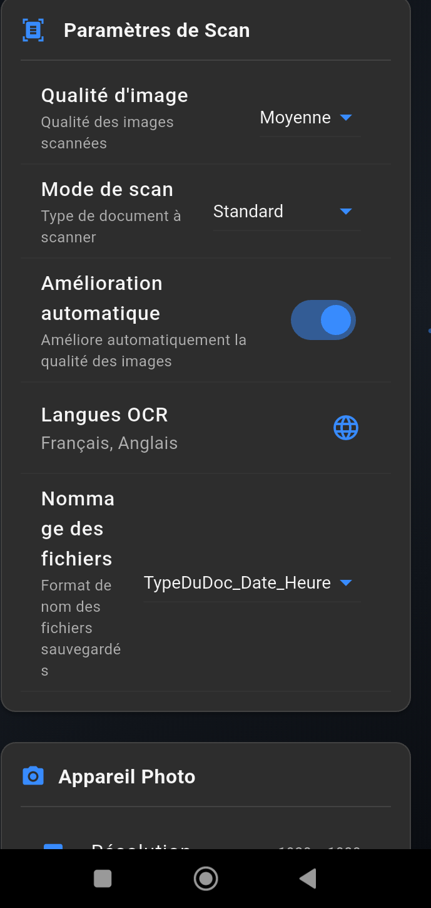
  <br><strong>Paramètres</strong>
  <br><em>Écran des paramètres de l’application.</em>
</p>

<p align="center">
  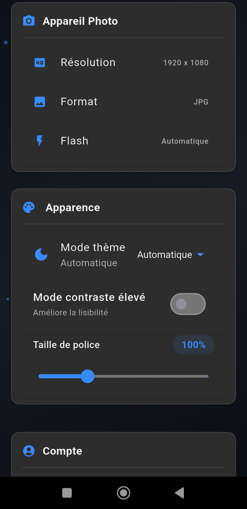
  <br><strong>Options de configuration</strong>
  <br><em>Vue complémentaire des options de configuration.</em>
</p>

<p align="center">
  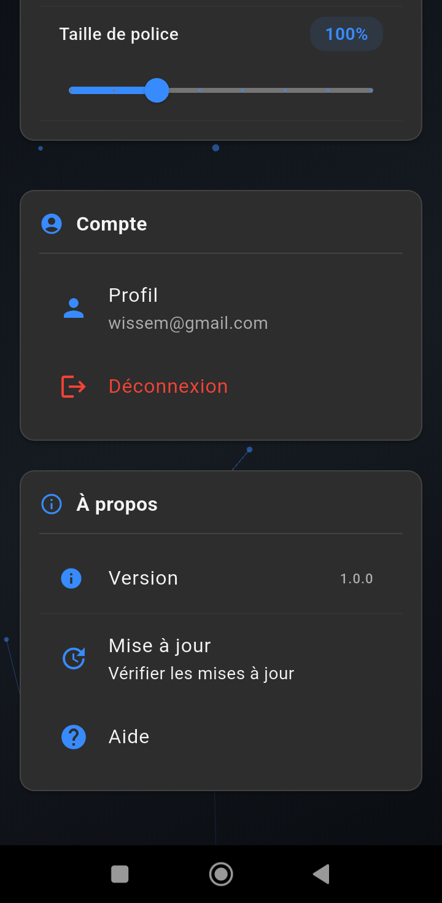
  <br><strong>Paramètres — vue complémentaire</strong>
  <br><em>Autre aperçu des paramètres disponibles.</em>
</p>

<p align="center">
  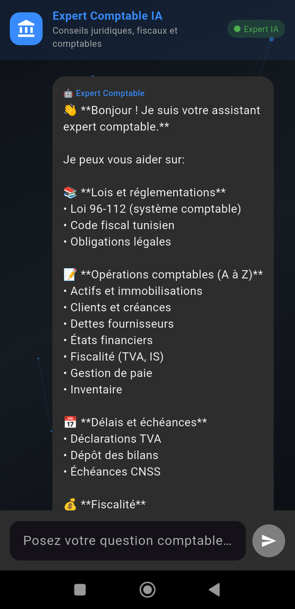
  <br><strong>Assistance par discussion</strong>
  <br><em>Interface de discussion ou de messagerie.</em>
</p>

<p align="center">
  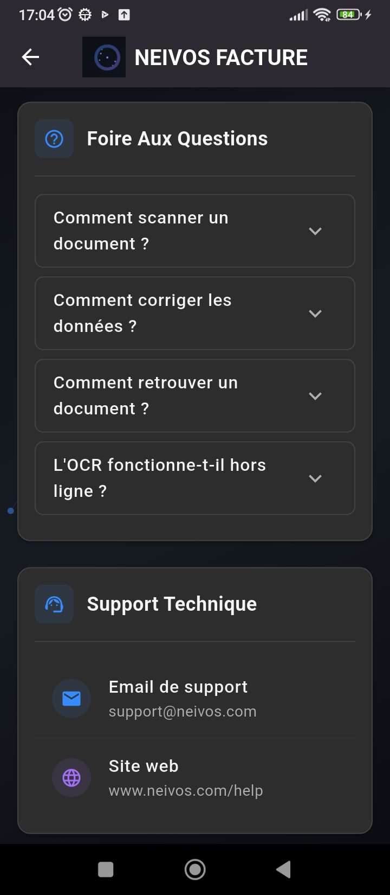
  <br><strong>Aide</strong>
  <br><em>Écran d’aide et d’assistance.</em>
</p>
