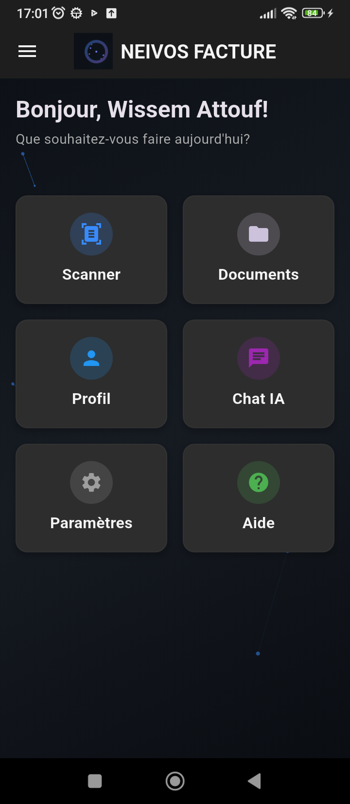
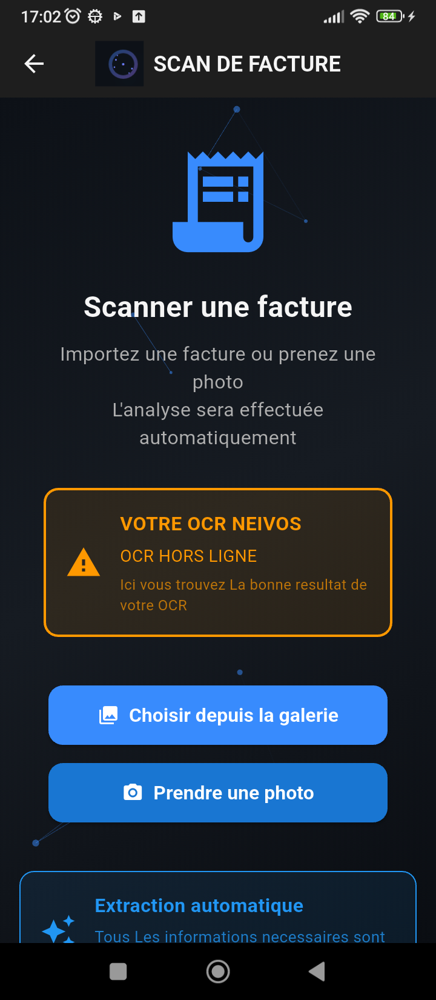
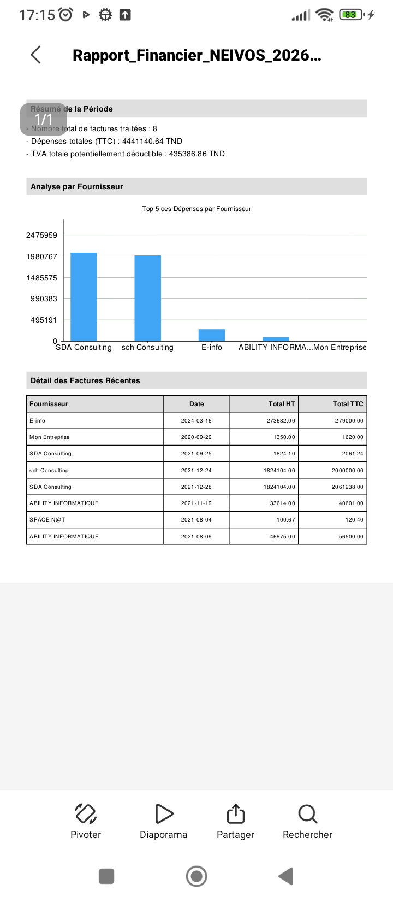
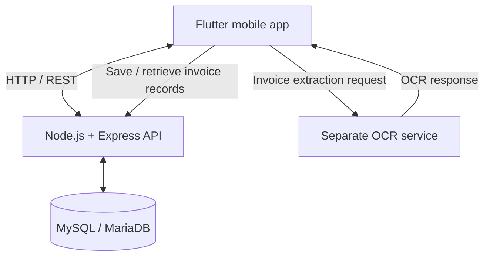

<div align="center">

# NEIVOS FACTURE

### Mobile invoice scanning · OCR-assisted extraction · Document management

A Flutter mobile application that helps users capture invoices, send them through an OCR-processing workflow, and organize invoice records with a connected REST API and relational database.

<p>
  
  
  
</p>

**Flutter** · **Dart** · **Node.js** · **Express** · **MySQL / MariaDB** · **OCR API**

</div>

---

## Overview

**Neivos Facture** is a mobile invoice-management project built around a practical workflow: capture or select an invoice, submit it for OCR-based extraction, review structured information, and keep invoice records available for later consultation.

The project brings together several parts of a full-stack application:

- A **Flutter / Dart** mobile interface.
- A **Node.js / Express** backend exposing REST endpoints.
- **MySQL / MariaDB** for persistent application data.
- Integration with a **separate OCR service** for invoice extraction.
- User-facing screens for scanning, documents, profile, scan settings, and help.
- Examples of invoice data and financial reports in spreadsheet and PDF formats.

The screenshots below are from the application provided for this repository. They demonstrate visible UI and example outputs; they should not be interpreted as proof that every workflow is always available or production-ready.

## Why this project is valuable

Invoice processing is a useful example of a real-world digital workflow. Information is held in documents, yet users often need to search, organize, and reuse that information in a structured way. Neivos Facture explores how a mobile application can connect document capture to OCR processing and invoice record management.

From an engineering perspective, the project demonstrates work across multiple application layers:

- **Mobile development:** composing a multi-screen Flutter experience.
- **REST API integration:** connecting the mobile client to backend endpoints.
- **Document-processing integration:** communicating with a separate OCR service and representing processing states in the UI.
- **Relational persistence:** using a MySQL/MariaDB-backed API for invoice records.
- **User workflows:** bringing scanning, history, profile, settings, and help into one application.
- **Financial data presentation:** displaying extracted invoice values and sample reporting outputs.

## Key features

### Invoice capture and OCR workflow

- Select an invoice image from the gallery or take a photo.
- Present a processing workflow with steps for image submission, text recognition, data extraction, structuring, and validation.
- Integrate with a separate NEIVOS OCR endpoint.
- Show an OCR availability state in the interface. OCR processing depends on the remote service being reachable; the application should not be described as performing OCR offline.

### Invoice organization

- Browse saved invoice records.
- Search invoices and use visible filters such as all, recent, and older records.
- Display supplier, invoice amount, and creation date in the invoice list.
- Access document-related actions from the interface.

### User profile and settings

- View the user profile and edit profile information.
- Access scan preferences, including image quality, scan mode, automatic image enhancement, OCR languages, and file-naming options.

### Help and reporting

- Consult an in-app FAQ and support information.
- Review invoice data in a spreadsheet-style example.
- View a PDF financial report example containing a period summary, supplier-level analysis, and a recent-invoice table.

> Feature availability depends on the running environment and service connectivity. Backend routes and UI screens should be tested end-to-end before making stronger reliability or production-readiness claims.

## Screenshots

### 1. Home dashboard

The dashboard provides entry points to scanning, documents, profile, AI chat, settings, and help.

<p align="center">
  
</p>

### 2. Invoice capture

Users can choose an image from the gallery or take a new photo to begin the invoice-processing workflow.

<p align="center">
  
</p>

### 3. OCR processing

The interface presents the main stages of the extraction workflow. The screenshot also shows an OCR-offline warning, illustrating why service availability and error states matter in a connected application.

<p align="center">
  
</p>

### 4. Invoice history

The document list shows search, filters, invoice count, total amount, supplier, amount, and creation date.

<p align="center">
  
</p>

### 5. Profile and scan settings

<p align="center">
  
  &nbsp;&nbsp;
  
</p>

### 6. Help center

The help screen groups frequently asked questions and support information.

<p align="center">
  
</p>

### 7. Example extracted data and financial report

The supplied examples illustrate invoice fields such as supplier, customer, date, totals before and after tax, VAT, fiscal stamp, and OCR confidence, as well as a financial summary grouped by supplier.

<p align="center">
  
  &nbsp;&nbsp;
  
</p>

**Privacy note:** review all screenshots before publishing the repository publicly. Replace personal profile details, email addresses, supplier names, invoice numbers, financial amounts, and any customer data with synthetic examples or redact them where appropriate.

## Architecture



- **Flutter client:** renders the mobile UI and calls backend/OCR endpoints.
- **Node.js / Express API:** provides application routes for health checks, authentication-related operations, profile management, invoice records, statistics, and administration.
- **MySQL / MariaDB:** stores application data accessed by the backend.
- **OCR service:** runs separately from the local backend and is used for invoice extraction.

The development setup described for this project uses a local Node.js backend on port `8086`, a local MySQL/MariaDB database, and a separately hosted OCR endpoint on port `8775`. The OCR service is not the same component as the Node.js backend.

## Technology stack

| Layer | Technology | Role |
|---|---|---|
| Mobile | Flutter, Dart | Mobile UI and client-side workflows |
| Backend | Node.js, Express | REST API and application request handling |
| Database | MySQL / MariaDB | Relational data persistence |
| OCR integration | HTTP API | Invoice text/data extraction |
| Development tools | Android Studio, Android Emulator, XAMPP, PowerShell | Local development and testing |

## Backend API overview

The backend currently declares the following routes. This is a high-level overview, not a complete OpenAPI specification; verify request bodies, authorization rules, and response schemas against the source code.

| Method | Route | Purpose |
|---|---|---|
| `GET` | `/health` | Check backend availability |
| `POST` | `/register` | User registration |
| `POST` | `/login` | User authentication |
| `POST` | `/forgot-password` | Start password-recovery flow |
| `GET` | `/profile` | Retrieve the authenticated user's profile |
| `PUT` | `/profile` | Update profile information |
| `POST` | `/api/invoices/save` | Save an invoice record |
| `GET` | `/api/invoices/user/:userId` | Retrieve invoice records for a user |
| `DELETE` | `/api/invoices/:invoiceId` | Delete an invoice record |
| `GET` | `/api/user/stats` | Retrieve user statistics |
| `POST` | `/api/ocr/process` | Handle an OCR-related backend request |
| Various | `/api/admin/...` | Administrative route group |

The Flutter OCR integration also uses the separate OCR service's `/extract-invoices/` endpoint. Keep the OCR URL and the Node.js API base URL configured independently.

## Run locally

These instructions describe the known local development setup. Confirm the actual npm scripts and required environment variables in the repository before running commands.

### Prerequisites

- Flutter SDK and Dart SDK compatible with the project.
- Android Studio and an Android Emulator (or a correctly configured Android device).
- Node.js and npm.
- MySQL/MariaDB; the existing local setup uses XAMPP.
- Network access to the configured OCR service for OCR extraction.

### 1. Start the database

1. Start MySQL from XAMPP.
2. Ensure the `ocr_scanner_db` database and the expected schema exist.
3. Back up existing data before running migrations or changing tables.

### 2. Configure and start the backend

```powershell
cd backend_api
npm install
```

Create a local `.env` file using the variable names expected by the backend. The current setup uses configuration values equivalent to:

```dotenv
DB_HOST=localhost
DB_PORT=3306
DB_USER=root
DB_NAME=ocr_scanner_db
PORT=8086
OCR_API_URL=http://37.60.239.139:8775
```

Add any other variables required by the implementation. Never commit `.env`, passwords, tokens, or other secrets. Check `package.json` for the actual start script before starting the backend.

Check backend health at:

```text
http://127.0.0.1:8086/health
```

A successful health response confirms that the backend is reachable. It does not alone prove that OCR processing or every database operation works.

### 3. Configure and run Flutter

From the Flutter project root:

```powershell
flutter pub get
flutter run
```

For the standard Android Emulator, the host alias `10.0.2.2` lets the emulator reach a service running on the development computer. Configure the Node.js backend base URL accordingly where the Flutter code expects it. Keep the OCR endpoint separate and unchanged unless its administrator supplies a new address.

If multiple Flutter files define their own API URLs, update them consistently. A shared configuration class helps avoid environment-specific addresses drifting apart.

## Security and quality checklist

Before publishing the repository or sharing it with recruiters:

- [ ] `.env`, credentials, tokens, and private keys are excluded from Git.
- [ ] Screenshots contain no personal or customer information that should remain private.
- [ ] Authentication and authorization are verified for protected routes.
- [ ] The backend checks invoice ownership instead of trusting a client-supplied user ID.
- [ ] Inputs and uploaded files are validated and size-limited.
- [ ] Error responses do not expose credentials, stack traces, or internal details.
- [ ] OCR connectivity failures are handled clearly in the UI.
- [ ] Tests are run and their results are recorded honestly.
- [ ] HTTPS, production hosting, automated CI/CD, and monitoring are not claimed unless actually configured and verified.

## Suggested next improvements

- Add automated tests for authentication, invoice ownership, and error handling.
- Document concrete API request/response examples or generate an OpenAPI specification.
- Test OCR success, timeout, malformed responses, and offline states.
- Add consistent loading, empty, and retry states across the app.
- Add formatting, static analysis, and test checks to CI.
- Document supported invoice formats and known OCR limitations.

## Project status

Neivos Facture is presented here as a full-stack mobile project under local development and validation. The screenshots demonstrate implemented UI areas and example reporting outputs; end-to-end reliability and production readiness should be claimed only after the corresponding tests have passed.

## Author

**Wissem Attouf** — Software Engineer | Full Stack Developer

- GitHub: [WissemAttouf](https://github.com/WissemAttouf)
- LinkedIn: [Wissem Attouf](https://www.linkedin.com/in/wissem-attouf-452509226/)

---

<div align="center">

*Mobile development · REST API integration · Relational data · OCR-based document workflows*

</div>
