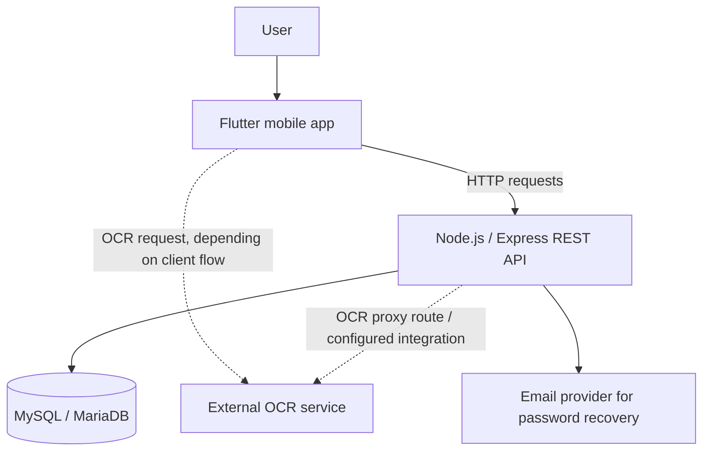

# Neivos Facture — Architecture

This document describes the main components visible in the repository. It is an implementation overview, not a claim that every flow has been validated end-to-end.

## High-level view

The Flutter client, REST API, database, OCR service, and email provider are separate responsibilities. The OCR service is external to the Node.js backend; OCR availability therefore depends on its configured endpoint and network connectivity.

## Components

### Mobile client — Flutter / Dart

The mobile application is organized under `lib/`:

- `screens/` — user-facing application screens.
- `services/` — API and integration logic.
- `models/` — application data models.
- `providers/` — state management using Provider.
- `config/` — configuration-related code.
- `widgets/` — reusable UI components.
- `utils/` — shared utilities.

Dependencies in `pubspec.yaml` include HTTP requests, image selection and processing, local preferences, spreadsheet/CSV export, PDF generation/printing, file sharing, and chart rendering.

### REST API — Node.js / Express

The backend lives in `backend_api/`. The entry point is `server.js`; database access is centralized in `db.js`.

The source uses Express middleware, JWT verification, bcrypt password hashing, Multer uploads, Axios/FormData for HTTP integration, and Nodemailer for email delivery. The server requires `JWT_SECRET` at startup.

### Relational database — MySQL / MariaDB

`backend_api/db.js` creates a MySQL connection pool using the `DB_HOST`, `DB_PORT`, `DB_USER`, `DB_PASSWORD`, and `DB_NAME` environment variables. The expected local database name in the current development configuration is `ocr_scanner_db`.

The repository documentation does not replace a schema/migration file. Confirm the required tables and columns against the database setup used by the project.

### OCR integration

The backend reads the OCR service base URL from `OCR_API_URL`, with a source-code fallback if the variable is absent. For reproducible local setup, configure the endpoint explicitly in your private `.env` file.

A typical user-facing workflow is:

1. Choose an invoice image or capture it with the device.
2. Submit the document to the OCR-enabled flow.
3. Wait for the remote OCR service to process the request.
4. Review the structured result shown by the application.
5. Save or consult invoice records through the backend where that workflow is connected.

The exact OCR response fields, confidence scoring, supported languages, and error-retry guarantees must be verified against the OCR service contract and the corresponding client/backend code. The app should not be described as performing OCR offline.

## Local runtime addresses

- Backend default port: `8086` (configurable with `PORT`).
- Backend health check: `http://127.0.0.1:8086/health`.
- OCR service: configured separately with `OCR_API_URL`; do not commit private endpoints or credentials.
- Android Emulator: use `10.0.2.2` to reach a service running on the host machine from the standard Android Emulator.

## Security notes

- Keep `.env` local and out of version control.
- Use a strong, unique `JWT_SECRET`.
- Do not use a privileged database account in a deployed environment.
- Review authentication and invoice ownership checks before production use.
- Do not expose uploaded invoices or profile images publicly unless that is intentional and access-controlled.
- Avoid sharing real invoices or personal information in screenshots, issues, or logs.
